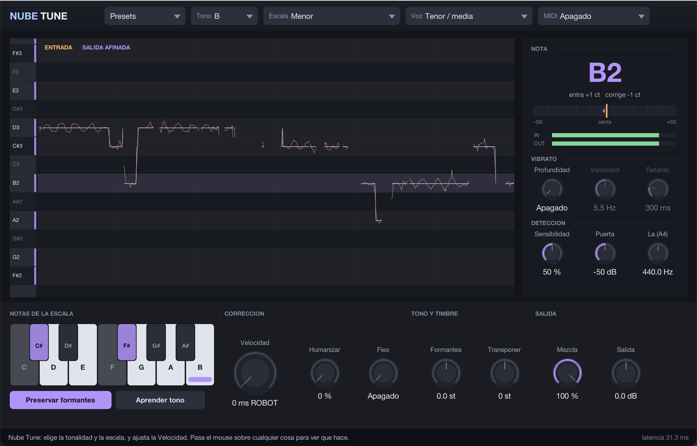

<!-- en -->
# Nube Tune

A free automatic pitch corrector (auto-tune) for [REAPER](https://www.reaper.fm), written as a JSFX (macOS / Windows /
Linux), part of the [Nube plugins](https://github.com/KevinMeneses/nube-plugins).



Key + 12 scales or any custom set of notes (click the on-screen keyboard), retune speed from robot (0 ms) to natural,
humanize, flex-tune, formant-preserving pitch shifting (pitch-synchronous PSOLA) with a separate formant control,
transpose ±24 semitones, added vibrato, A4 reference, MIDI target notes (held notes = scale, or exact note), key
detection, live piano-roll pitch graph, 13 presets. ~3 % CPU, 31 ms latency (compensated by REAPER).

**Install** — with [ReaPack](https://reapack.com): *Extensions → ReaPack → Import repositories*, paste
`https://github.com/KevinMeneses/nube-plugins/raw/main/index.xml`, then install **Nube Tune**. Or copy `nube_tune.jsfx`
into `REAPER/Effects/Nube Tune/` (on macOS `./install.sh` links it). It shows up as **JS: Nube Tune**. The interface is
in Spanish.

**How it was made** — designed and built with [Claude Code](https://claude.com/claude-code). Since an AI can't
listen, every feature is verified by rendering test cases inside REAPER and comparing them with the theory
(`tests/run.sh`: pitch to ±0.1 cent, formants by LPC, retune time constants, vibrato depth, MIDI, null tests), plus
mouse-driven UI tests (`tests/ui_test.py`).

**License** — GPL-3.0-or-later (see `LICENSE`).

---

## Español
Afinador automático (autotune) para REAPER (JSFX, macOS/Windows/Linux), hermano de Nube EQ, Nube Comp, Nube Verb,
Nube Delay, Nube De-Ess, Nube Limit, Nube Gate, Nube Synth y Nube Sampler.


- **Tonalidad y escala**: 12 tónicas × Cromática, Mayor, Menor, Menor armónica, Menor melódica, Pentatónica mayor y
  menor, Blues, Dórica, Frigia, Lidia, Mixolidia, o **Personalizada**: clic en el teclado (o en los nombres de la
  gráfica) para quitar o activar notas.
- **Velocidad** (0–400 ms): 0 = efecto robot (T-Pain), 10–30 ms = pop moderno, 50–100 ms = natural. Constante de
  tiempo real: con 100 ms, a los 100 ms queda el 37 % de la desafinación (medido: 11 de 39 cents).
- **Humanizar**: en las notas largas corrige más lento (pasa el vibrato) sin dejar de afinar los cambios de nota.
- **Flex**: solo corrige cuando ya cantas cerca de la nota; los adornos y deslizamientos lejos de ella pasan.
- **Formantes**: PSOLA sincrónico al período (granos de dos períodos centrados en marcas enganchadas al período real
  por correlación): al transponer, el timbre se preserva (F1/F2 medidos por LPC: ±1 %). Perilla de **Formantes**
  (±12 st, sin cambiar la nota) y modo **siguen el tono** (ardilla / monstruo).
- **Transponer** ±24 semitonos sobre la nota ya afinada; **vibrato** agregado (profundidad, velocidad, retardo);
  **La de referencia** 415–465 Hz.
- **MIDI**: *Notas tocadas = escala* (las teclas que mantienes son las notas permitidas) o *Nota exacta* (la voz va a
  la nota MIDI). El MIDI pasa de largo.
- **Aprender tono**: escucha la canción y pone la tonalidad y la escala (perfiles de Krumhansl).
- **Rango de voz** (soprano/alto, tenor, barítono/bajo, instrumento grave): más agudo = menos latencia.
  Sensibilidad (umbral de voz de YIN) y puerta (lo que está bajo ese nivel no se analiza).
- **Interfaz**: gráfica tipo rollo de piano (ámbar = entra, violeta = sale afinada; rueda = zoom, arrastrar = mover,
  doble clic = seguir la voz), nota actual grande con medidor de cents (desafinación y corrección), teclado de la
  escala, medidores, ayuda de cada control en el pie, latencia.
- **13 presets** (no cambian la tonalidad): natural, pop, hard tune, trap melódico, balada, solo centrar notas largas,
  octava abajo / arriba, monstruo, ardilla, vibrato agregado, doble afinado (mezcla 50 %), por defecto.
- Latencia: 31 ms (tenor), 22 ms (soprano), 40 ms (barítono), REAPER la compensa. CPU: ~2.9 % de un núcleo por
  instancia (3.2 % en el peor caso).

## Instalar

```sh
./install.sh
```

Crea un enlace en `~/Library/Application Support/REAPER/Effects/Nube Tune/`. En REAPER aparece como
**JS: Nube Tune**. Si cambias el código, vuelve a insertar el FX.

## Cómo se usa

1. Pon Nube Tune en la pista de la voz (antes de compresor y reverb).
2. Elige **Tono** y **Escala** (o usa **Aprender tono**: reproduce unos segundos y apágalo).
3. Ajusta **Velocidad**: 0 para el efecto, 20–50 ms para afinar sin que se note. Si la voz tiene vibrato bonito,
   sube **Humanizar**.
4. Si salta a notas raras: quita esas notas en el teclado, o elige el **Rango de voz** correcto.

| Acción | Cómo |
|---|---|
| Perillas | Arrastra arriba/abajo o rueda; **Shift** = fino; **doble clic** = valor por defecto |
| Notas de la escala | Clic en el teclado o en los nombres de la gráfica |
| Gráfica | Rueda = zoom, arrastrar = mover, doble clic = seguir la voz, clic derecho = presets |

## Pruebas

- `tests/run.sh [patrón]` (`NUBE_PY=/ruta/a/python`): renderiza 54 casos en una pestaña temporal de REAPER y los compara con
  la teoría (83 chequeos): afinación exacta (±0.5 cents; medida −0.04 a 48, 44.1 y 96 kHz), las escalas, notas
  personalizadas, transponer ±12 / +7 / −7, La = 432, voz grave a 84 Hz, formantes por LPC (preservar ±1 %, seguir el
  tono +26 %, perilla ±3 st), nivel, periodicidad de la salida, velocidad 0 y 100 ms, flex 50 / 100 %, vibrato
  (aplanado / respetado / humanizar), vibrato agregado (6.01 Hz) y su retardo, MIDI (nota exacta, notas = escala,
  secuencia), mezcla 0 % idéntica y alineada (−129 dB), voz ya afinada sin cambios (armónicos ±0.04 dB), ruido intacto,
  silencio, glissando en escalera sin huecos, aprender tonalidad (melodía en Mi menor → E menor) y la voz real (hard
  tune: desafinación mediana 1.8 ct contra 8 ct de la entrada; 0.2 % de saltos de octava; ±12 st exactos; presets).
  `tests/out/log.txt` trae un diagnóstico del motor (granos que pidieron audio aún no llegado): 0 en todos.
- `tests/ui_test.py` (+ `ui.py`, `ui_dump.lua`, `scroll.swift`, `winid.swift`, `reopen.sh`): 24 pruebas de la interfaz
  con el mouse (`cliclick`), con el mismo arnés de Nube Sampler (ubica la ventana, clic de foco antes de cada acción,
  capturas por id de ventana; si un evento no llega se repite una vez y se informa). `NUBE_KEY=9 NUBE_SCALE=2
  tests/reopen.sh` abre la demo; `tests/ui_close.lua` la cierra y `tests/tabs.lua` lista / cierra las pestañas de prueba.
- `tools/check_names.py`: avisa si dos identificadores solo difieren en mayúsculas (lo corren `run.sh` y `reopen.sh`).
- `tests/perf.lua`: CPU.

## Detalles técnicos

- Detección: YIN con la diferencia calculada por FFT (cada 5.3 ms, ventana = período máximo), interpolación
  parabólica, protección de octava. Corrección por cuadro (nota más cercana permitida con histéresis de 10 cents,
  suavizado de un polo con la Velocidad, humanizar, flex, vibrato, transponer).
- Síntesis: TD-PSOLA. Marcas de análisis cada período (refinadas por correlación normalizada ±8 %), marcas de síntesis
  cada `srate / f_salida`; cada grano usa la ventana de Hann asimétrica hasta las marcas vecinas (con la misma marca y
  período suma exactamente 1: transparente), ganancia `sqrt(formante / densidad)` para mantener el nivel. Sin voz, los
  granos vuelven a alinearse con la entrada (el ruido pasa bit a bit).
- Latencia fija `max(2.62 · Pmax, 2.2 · Pmax + hop)` según el rango de voz, reportada a REAPER (`pdc_delay`).
- Trampas de EEL2 (las mismas de los otros Nube): variables sin distinción de mayúsculas, nada de notación científica,
  `while (c) ( ... )` con el cuerpo entre paréntesis, y `@gfx` corre en otro hilo (las temporales del audio llevan
  prefijo `a_` / `b_`).

Nota sobre las pruebas: necesitan REAPER y Python con numpy, scipy y soundfile. Los casos con voz real usan una
grabación propia que no está en el repo (`tests/signals/voz.wav`); sin ella esos casos no se pueden correr.
